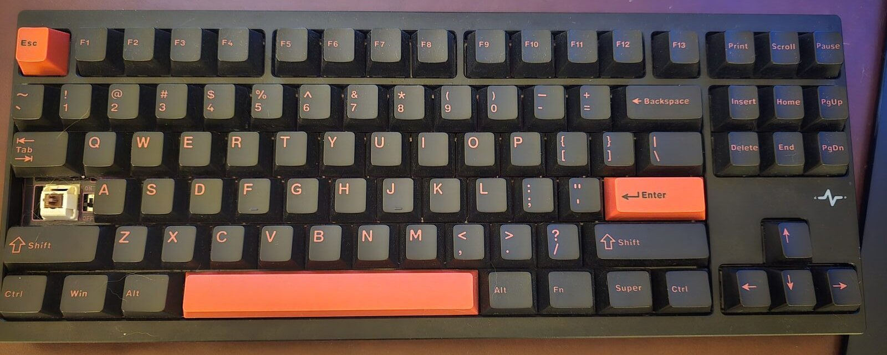

<div align="center">

# Wobkey Crush 80 · ZMK

**Open-source firmware for the Wobkey Crush 80 (Reboot Pro) mechanical keyboard.**
Replaces the closed vendor firmware with [ZMK](https://zmk.dev): USB, Bluetooth,
154 per-key RGB LEDs, OpenRGB, ZMK Studio, and one-cable updates.

[](LICENSE)
[](https://zmk.dev)
[](https://www.zephyrproject.org)
[](docs/hardware.md)
[](docs/hardware.md)
[](#features)
[](#status)
[](https://www.ritwickverma.dev/)
[](https://buycovfefefor.ritwickverma.dev/)



</div>

## Why

The Crush 80 ships with a proprietary firmware from Evision Semiconductor that
only *imitates* VIA. It runs on a **Telink TLSR9511**, a RISC-V Bluetooth SoC
that QMK does not support, so "just flash QMK" is impossible. ZMK runs on
Zephyr, and Zephyr runs on this chip. This repository is the board port, the
drivers it needed, and the tooling to get it onto a stock keyboard without
opening it.

## Features

- **Full keyboard over USB and Bluetooth LE**: 88-key ANSI matrix (F13 included), three
  Bluetooth profiles, USB/BLE output switching, deep sleep with key wakeup.
- **154 per-key RGB LEDs**: WS2812-class chain driven by SPI + DMA, with the
  `rainy_rgb` engine (12 effects, reactive ripples and heatmap, Caps Lock and
  battery indicators) and on-keyboard controls.
- **OpenRGB**: direct per-LED control from [OpenRGB](https://openrgb.org) over a
  raw HID interface (QMK OpenRGB protocol), so the keyboard joins your desktop
  lighting. [Setup](docs/openrgb.md).
- **ZMK Studio**: remap keys live from the browser over Bluetooth.
- **One-cable install** from the stock firmware, via its own update protocol.
- **Safe updates**: MCUboot's USB recovery plus `update.sh` flash in about 11
  seconds, and a bad image never boots.
- **Mac mode** (Fn+M) and an advanced home-row-mods keymap in `keymaps/`.

## Quick start

```bash
git clone https://gitlab.com/ritwick7/crush80-zmk.git && cd crush80-zmk
bash setup.sh                     # Zephyr SDK, west workspace, Python deps (~10 min)
sudo cp udev/99-wobkey-crush80.rules /etc/udev/rules.d/ && sudo udevadm trigger
bash build.sh --build-mcuboot     # -> dist/
```

| Your keyboard runs | Do this |
|---|---|
| Stock Wobkey firmware | `bash install_zmk.sh` |
| This firmware | [Update](docs/flashing.md#update-a-keyboard-that-runs-zmk) (recovery mode, then `bash update.sh`) |
| Something broken | [Recovery](docs/flashing.md#recovery) |

Full instructions, including recovery and going back to stock:
**[docs/flashing.md](docs/flashing.md)**.

> [!WARNING]
> Flashing third-party firmware can leave the keyboard unusable until it is
> reflashed. The tools never touch the factory calibration and Bluetooth MAC
> area, and MCUboot refuses to boot a bad image, but keep a second keyboard
> nearby the first time.

## Keymap

| Fn + | Action | Fn + | Action |
|---|---|---|---|
| Esc | Bootloader (see known issues) | 1 / 2 / 3 | Bluetooth profile |
| F1 / F2 | Screen brightness | 4 | USB output |
| F3 / F4 / F5 | Previous / play / next | 5 | Toggle USB / Bluetooth |
| F6 / F7 / F8 | Mute / volume | Ins | Clear Bluetooth pairing |
| F12 | Unlock ZMK Studio | M | Mac mode: Win/Alt become Option/Cmd |
| Backspace | RGB on / off | ScrLk | Native (pass-through) layer |
| \ or Enter | Next RGB effect | ↑ / ↓ | RGB brightness |

Keys go to one output at a time. If the cable is in one computer while
Bluetooth is connected to another, typing goes to the Bluetooth host and the
cabled one gets nothing: press Fn+4 for USB. The choice is saved.

The board keymap is [`zmk/boards/crush80/crush80.keymap`](zmk/boards/crush80/crush80.keymap).
Edit it directly, point `CRUSH80_KEYMAP` at your own file, or remap live in
[ZMK Studio](https://zmk.studio): open it in Chrome or Edge (it connects over
Web Bluetooth), connect to the keyboard, then press Fn+F12 to unlock. Changes
are saved on the keyboard. Studio can also add up to three new layers. Combos,
macros and hold-tap timings are not editable in Studio; change those in the
keymap file and reflash.

## Inside the keyboard

| | |
|---|---|
|  |  |
| The full PCB: 154 LED footprints, MCU top left | Telink TLSR9511 with its 24 MHz crystal |

Pinout, LED chain, flash map and stock-firmware notes:
**[docs/hardware.md](docs/hardware.md)**.

## Status

| | |
|---|---|
| Typing, USB, Bluetooth | Working, daily use |
| Per-key RGB, OpenRGB (Direct mode, 154 LEDs) | Working |
| Updates over USB (`update.sh` / `dfu.py`) | Working: 290 KB in 11 s |
| ZMK Studio | Over Bluetooth (the USB serial port was dropped so OpenRGB sees the keyboard) |
| Fn+Esc → bootloader | **Known issue**: reboots into the app instead. Use `scripts/force_recovery.py` ([details](docs/flashing.md#update-a-keyboard-that-runs-zmk)) |
| 2.4 GHz dongle | Not supported: proprietary protocol, no open implementation exists |
| Battery percentage | Reads; scaling not yet calibrated on this board |

## Repository layout

```
zmk/              ZMK module: board (DTS, keymap), drivers (USB, BLE, LED strip,
                  battery, watchdog), rainy_rgb engine, OpenRGB, flash management
conf/             build configuration (app, MCUboot, install bridge)
patches/          fixes to Zephyr, ZMK, MCUboot and hal_telink, applied by setup.sh
keymaps/          stock and home-row-mods keymaps
scripts/          dfu.py (updates), force_recovery.py, OTA + install tools
docs/             hardware notes, flashing and recovery guide, photos
```

## Credits

- **[Adam Yung](https://github.com/Adam-Yung/Crush80_ZMK)**: the original ZMK port
  of the Crush 80. This repository is a fork with history preserved.
- **[scholzri / rainy75-zmk](https://github.com/scholzri/rainy75-zmk)**: the port
  and reverse engineering of the sibling Wobkey Rainy 75 Pro, which supplied the
  Telink B91 drivers, the RGB engine and the patches.
- [ZMK](https://zmk.dev), [Zephyr](https://zephyrproject.org) and
  [MCUboot](https://www.trustedfirmware.org/projects/mcuboot/).

## License

[Apache License 2.0](LICENSE). See [NOTICE](NOTICE) for provenance and
third-party components. The Telink Bluetooth controller library is proprietary:
it is downloaded at build time and is not part of this repository, and firmware
images built with it must not be redistributed (which is why there are no
prebuilt releases).

If this saved your keyboard from the vendor firmware, you can
[buy me a covfefe](https://buycovfefefor.ritwickverma.dev/).

This is an independent project, not affiliated with Wobkey, Telink or Evision.
