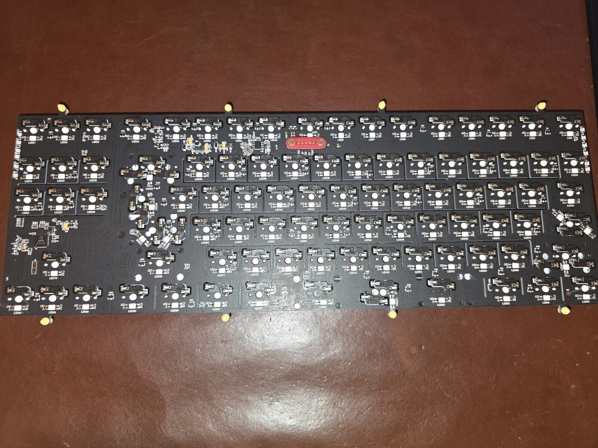
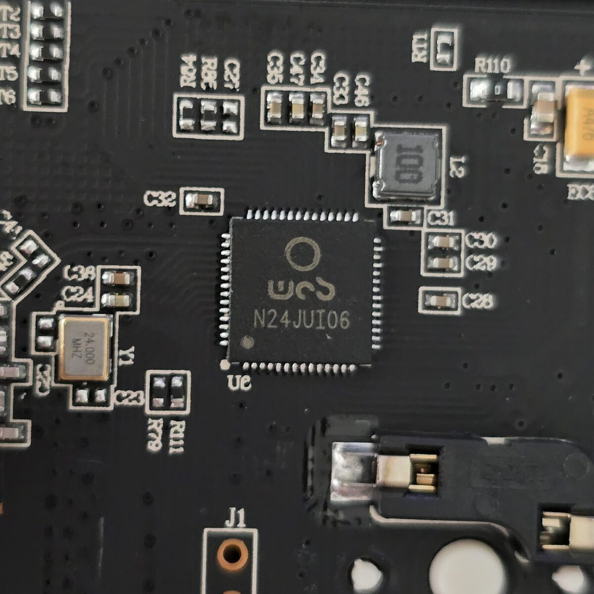

<div align="center">

# Wobkey Crush 80 · ZMK

**Open-source firmware for the Wobkey Crush 80 (Reboot Pro) mechanical keyboard.**
Replaces the closed vendor firmware with [ZMK](https://zmk.dev): USB, Bluetooth,
154 per-key RGB LEDs, OpenRGB, ZMK Studio, and one-cable updates.

[](LICENSE)
[](https://zmk.dev)
[](https://www.zephyrproject.org)
[](docs/hardware.md)
[](docs/hardware.md)
[](#features)
[](#status)
[](https://www.ritwickverma.dev/)
[](https://buycovfefefor.ritwickverma.dev/)


</div>

## Why

The Crush 80 ships with a proprietary firmware from Evision Semiconductor that
only *imitates* VIA. It runs on a **Telink TLSR9511**, a RISC-V Bluetooth SoC
that QMK does not support, so "just flash QMK" is impossible. ZMK runs on
Zephyr, and Zephyr runs on this chip. This repository is the board port, the
drivers it needed, and the tooling to get it onto a stock keyboard without
opening it.

## Features

- **Full keyboard over USB and Bluetooth LE**: 88-key ANSI matrix (F13 included), five
  Bluetooth profiles, USB/BLE output switching, deep sleep with key wakeup.
- **154 per-key RGB LEDs**: WS2812-class chain driven by SPI + DMA, with the
  `rainy_rgb` engine (12 effects, reactive ripples and heatmap, Caps Lock and
  battery indicators) and on-keyboard controls.
- **OpenRGB**: direct per-LED control from [OpenRGB](https://openrgb.org) over a
  raw HID interface (QMK OpenRGB protocol), so the keyboard joins your desktop
  lighting. [Setup](docs/openrgb.md).
- **Live remapping**: [VIA](docs/via.md) over USB, or ZMK Studio from the
  browser over Bluetooth.
- **One-cable install** from the stock firmware, via its own update protocol.
- **Safe updates**: MCUboot's USB recovery plus `update.sh` flash in about 11
  seconds, and a bad image never boots.
- **Mac mode** (Fn+M) and an advanced home-row-mods keymap in `keymaps/`.

## Quick start

```bash
git clone https://gitlab.com/ritwick7/crush80-zmk.git && cd crush80-zmk
bash setup.sh                     # Zephyr SDK, west workspace, Python deps (~10 min)
sudo cp udev/99-wobkey-crush80.rules /etc/udev/rules.d/ && sudo udevadm trigger
bash build.sh --build-mcuboot     # -> dist/
```

| Your keyboard runs | Do this |
|---|---|
| Stock Wobkey firmware | `bash install_zmk.sh` |
| This firmware | [Update](docs/flashing.md#update-a-keyboard-that-runs-zmk) (recovery mode, then `bash update.sh`) |
| Something broken | [Recovery](docs/flashing.md#recovery) |

Full instructions, including recovery and going back to stock:
**[docs/flashing.md](docs/flashing.md)**.

> [!WARNING]
> Flashing third-party firmware can leave the keyboard unusable until it is
> reflashed. The tools never touch the factory calibration and Bluetooth MAC
> area, and MCUboot refuses to boot a bad image, but keep a second keyboard
> nearby the first time.

## Keymap

Base is a plain 80% layout: every key does what it says, Caps is Caps Lock, and
there are no hold-taps. All the extras sit behind the **Fn** key, which is a
plain hold, and every layer can be edited in VIA.

**Hold Fn**

| Fn + | Action | Fn + | Action |
|---|---|---|---|
| H J K L | ← ↓ ↑ → | U / O | Home / End |
| Y / N | Page up / down | X / ; | Backspace / Delete |
| A / D | Word left / right | W / S | Paragraph up / down |
| 1 2 3 / 6 7 | Bluetooth profiles 1-3 / 4-5 | 4 / 5 | USB output / toggle USB and Bluetooth |
| Del | Clear the current Bluetooth pairing | M | Mac mode on / off |
| PrtSc / ScrLk / Pause | Mute / volume up / brightness up | Ins / Home / PgUp | Previous / play / next |
| End / PgDn | Volume down / brightness down | Bspc | RGB on / off |
| \ or Enter | Next RGB effect | [ ] / - = | RGB hue / speed |
| ↑ / ↓ | RGB brightness | B | Show battery level |
| F12 | Unlock ZMK Studio | Esc | Recovery mode (see [flashing](docs/flashing.md)) |

Shift, Ctrl, Alt and Cmd keep working with these, so Shift+Fn+L selects a
character and Shift+Fn+D selects a word. A D W S send Ctrl+arrows. There is no real "sentence" keystroke in any OS; paragraph is the
closest, and it works in browsers, Word and most text fields.

**Hold Fn and Space: numpad and symbols**

Right hand: `7 8 9` on U I O, `4 5 6` on J K L, `1 2 3` on M , ., `0` on N, `.` on /,
and `- + = * /` on P ; ' [ ]. Left hand: `~ ! @ # $` on Q-T, `( ) { } |` on A-G,
`[ ] < > \` on Z-B.

**Hold the right Win key: numpad on the nav cluster**

Ins Home PgUp = `4 5 6`, Del End PgDn = `1 2 3`, and F13 PrtSc ScrLk Pause = `0 7 8 9`.
Hold Space as well to reach the **Macro** layer (layer 5): P plays macro 0 (edit it in VIA).
The right Win key does not type Win; the left one does.

**Both Shift keys together:** Caps Word (capitals until the next space or punctuation).
It is a combo, so ZMK holds a Shift press back for up to 40 ms to see if the other one follows.

**Mac mode (Fn+M):** Win and Alt swap to give Ctrl Opt Cmd in Apple's order, PrtSc
takes a Cmd+Shift+4 screenshot, and Home / End move to the start / end of the line.

**The keys show their state.** While you hold Fn, every key it binds lights white;
the active Bluetooth profile is blue (orange while it waits for a host), the USB key is
green when USB is the output, and the Mac key is orange when Mac mode is on.

Keys go to one output at a time. If the cable is in one computer while
Bluetooth is connected to another, typing goes to the Bluetooth host and the
cabled one gets nothing: press Fn+4 for USB. The choice is saved.

The keymap is [`config/crush80.keymap`](config/crush80.keymap). Ways to change it:

- **[VIA](docs/via.md)** (USB): edit keys, layers and macros at
  [usevia.app](https://usevia.app) after loading `config/via.json` once;
  ZMK-only keys (Bluetooth, RGB, output) are under *Special*. Combos and
  hold-tap timings are not available there.
- **[ZMK Studio](https://zmk.studio)** (Bluetooth): open it in Chrome or Edge,
  connect to the keyboard, then press Fn+F12 to unlock. Studio can also add up to
  three new layers (VIA shows the same three as spare layers 6-8). Combos, macros and hold-tap timings are not editable there
  either.
- **The keymap file**: edit it, or point `CRUSH80_KEYMAP` at your own file, then
  reflash with `python3 scripts/force_recovery.py`, replug USB,
  `bash update.sh --build`. This is the only way to change combos, hold-taps
  and home-row mods.

VIA and Studio edit the same stored keymap: a change in one shows in the other.
`config/crush80.keymap` is what the keyboard falls back to when that stored
keymap is reset. Normal firmware updates keep your live edits; a new layout
revision (`CONFIG_CRUSH80_KEYMAP_REV`, raised when the layer list changes) clears
them on first boot, so edits can never land on the wrong layer.

## Inside the keyboard

| | |
|---|---|
|  |  |
| The full PCB: 154 LED footprints, MCU top left | Telink TLSR9511 with its 24 MHz crystal |

Pinout, LED chain, flash map and stock-firmware notes:
**[docs/hardware.md](docs/hardware.md)**.

## Status

| | |
|---|---|
| Typing, USB, Bluetooth | Working, daily use |
| Per-key RGB, OpenRGB (Direct mode, 154 LEDs) | Working |
| Updates over USB (`update.sh` / `dfu.py`) | Working: 290 KB in 11 s |
| ZMK Studio | Over Bluetooth (the USB serial port was dropped so OpenRGB sees the keyboard) |
| VIA (keys, layers, 16 macros) | Working over USB, checked against the real app on Linux; not yet tried on macOS or Windows ([docs/via.md](docs/via.md)) |
| Fn+Esc → recovery | Erases the image header so MCUboot stays in USB recovery; built, **not yet confirmed on hardware**. Fallback: `scripts/force_recovery.py` ([details](docs/flashing.md#update-a-keyboard-that-runs-zmk)) |
| 2.4 GHz dongle | Not supported: proprietary protocol, no open implementation exists |
| Battery percentage | Reads; scaling not yet calibrated on this board |
| Timers | Run about 6% fast: 1000 ms of firmware time is about 940 ms real (measured against the host over 20 s), so tapping terms, macro delays and idle timeouts are that much shorter. The 32 kHz clock is calibrated at boot (`soc.c`) yet still reads fast; cause not found |

## Repository layout

```
config/           the keymap (crush80.keymap) and the generated VIA definition (via.json)
zmk/              ZMK module: board (DTS), drivers (USB, BLE, LED strip,
                  battery, watchdog), rainy_rgb engine, OpenRGB, flash management
conf/             build configuration (app, MCUboot, install bridge)
patches/          fixes to Zephyr, ZMK, MCUboot and hal_telink, applied by setup.sh
keymaps/          stock and home-row-mods keymaps
scripts/          dfu.py (updates), force_recovery.py, OTA + install tools
                  host tests of the firmware logic: bash zmk/tests/run_host_tests.sh
docs/             hardware notes, flashing and recovery guide, photos
```

## Credits

- **[Adam Yung](https://github.com/Adam-Yung/Crush80_ZMK)**: the original ZMK port
  of the Crush 80. This repository is a fork with history preserved.
- **[scholzri / rainy75-zmk](https://github.com/scholzri/rainy75-zmk)**: the port
  and reverse engineering of the sibling Wobkey Rainy 75 Pro, which supplied the
  Telink B91 drivers, the RGB engine and the patches.
- [ZMK](https://zmk.dev), [Zephyr](https://zephyrproject.org) and
  [MCUboot](https://www.trustedfirmware.org/projects/mcuboot/).

## License

[Apache License 2.0](LICENSE). See [NOTICE](NOTICE) for provenance and
third-party components. The Telink Bluetooth controller library is proprietary:
it is downloaded at build time and is not part of this repository, and firmware
images built with it must not be redistributed (which is why there are no
prebuilt releases).

If this saved your keyboard from the vendor firmware, you can
[buy me a covfefe](https://buycovfefefor.ritwickverma.dev/).

This is an independent project, not affiliated with Wobkey, Telink or Evision.
