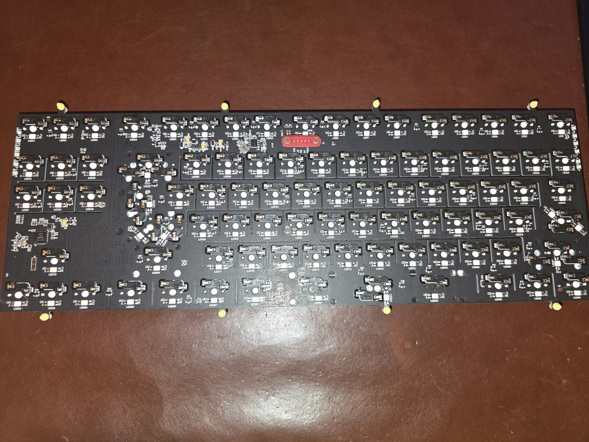
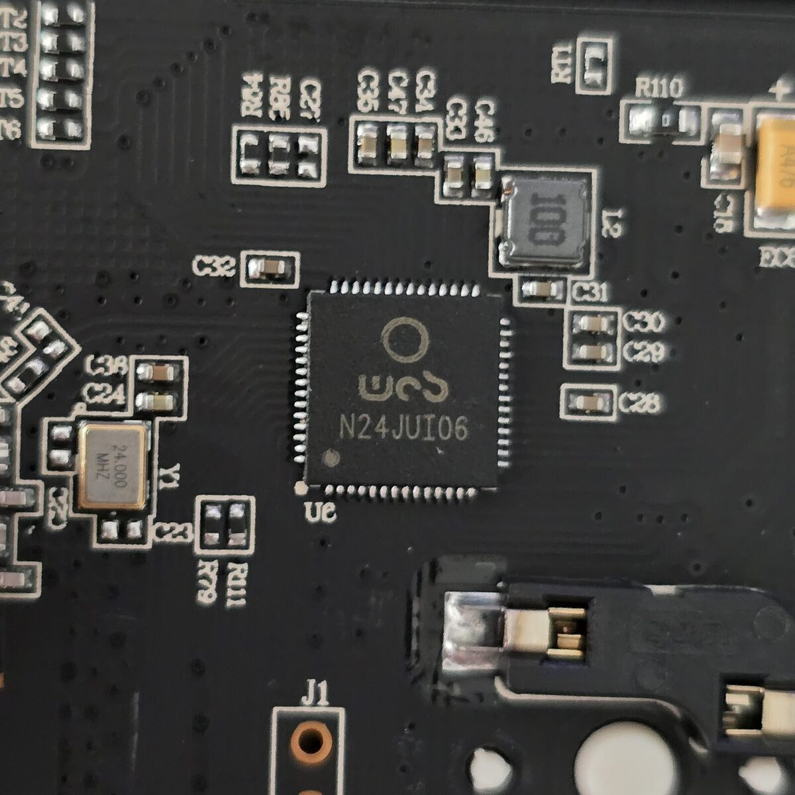
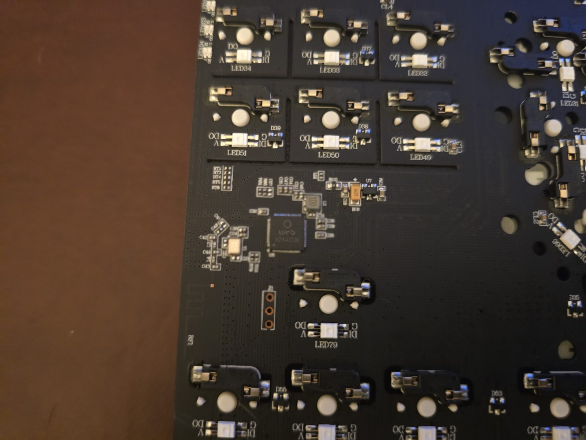
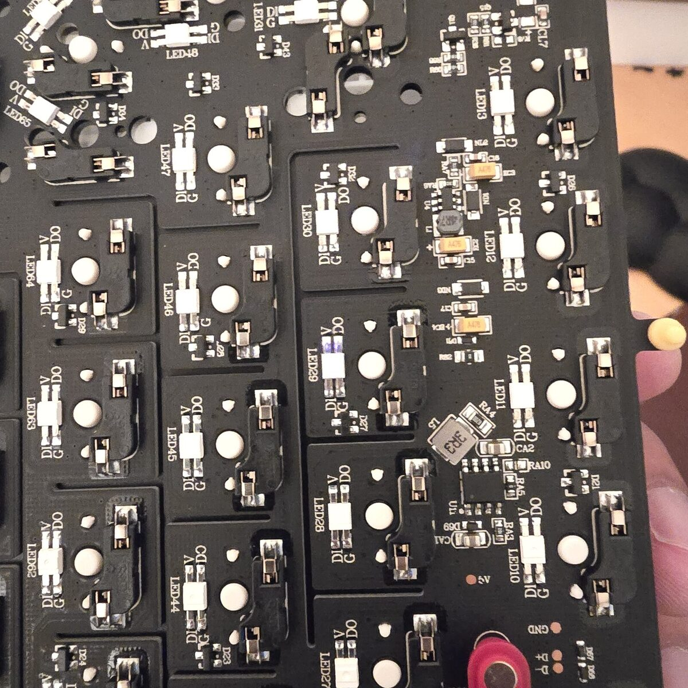
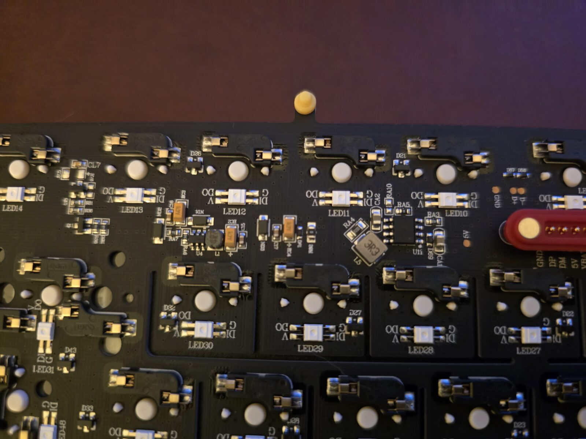

# Hardware

What is inside a Wobkey Crush 80 (Reboot Pro, RGB, tri-mode), as found by
opening one, reading the PCB and analysing the stock firmware. Pin assignments
below are the ones the firmware in this repository uses and that are verified on
hardware.

## Summary

| | |
|---|---|
| MCU | **Telink TLSR9511** (B91 family): RISC-V RV32IMAC + Andes V5 extensions, 48 MHz, 1 MB flash, 128 KB ILM + 128 KB DLM SRAM |
| Crystal | 24 MHz |
| Matrix | 6 rows × 16 columns, col2row, 88 keys (ANSI; F13 at matrix (4,12)) |
| LEDs | 154 addressable RGB LEDs (SK6812 MINI-E style), one daisy chain |
| Battery | Li-ion; voltage read on PD1 through a 1/2 divider (as on the Rainy 75; not yet calibrated on this board) |
| Radios | USB-C (full speed), Bluetooth LE 5, proprietary 2.4 GHz (dongle) |
| Stock firmware | Evision Semiconductor platform (not QMK), USB `320f:5055` |

## MCU

The package is marked only with a batch code (`N24JU106`) and a logo, which is
easy to mistake for another vendor. The stock firmware's USB string descriptor
says `TLSR9511`, its code disassembles as RISC-V, and every peripheral access
matches the Telink B91 register map. QMK has no port for this SoC, which is why
this project uses ZMK (Zephyr has B91 support).

The 3-pin header next to the MCU (J1) is most likely the Telink single-wire
debug (SWS) port, matching the GND / VCC / SWS pads on the sibling Rainy 75 (not
yet probed on this board). With a Telink Burning EVK, SWS reads and writes flash
directly: the recovery path of last resort.

## Key matrix

| | Pins |
|---|---|
| Columns (16) | PE0 PE1 PE2 PE4 PE5 PE6 PB0 PB1 PB2 PB3 PB4 PB5 PB6 PC0 PC1 PC4 |
| Rows (6) | PD7 PD2 PD3 PD4 PD5 PD6 |

The vendor VIA definition declares an 8 × 16 matrix; only six rows are wired.

## LEDs

Each LED footprint has four pads labelled **DI / DO / V / G**: data in, data
out, supply, ground, i.e. a WS2812-style daisy chain rather than an LED-matrix
driver. The chain is driven from **PB7** (the PSPI MOSI pin) with SPI-encoded
WS2812 timing and DMA, GRB colour order; **PC2** switches LED power through a
MOSFET. The first 92 LEDs sit under the keys, row by row, left to right; the
other 62 light the side bar and logo. Caps Lock and Enter have two LEDs each
and Space three, so 88 keys use 92 LEDs. The key-to-LED order comes from the
stock firmware's switch-to-LED table (v1.04 image, inner offset `0x1B90C`) and
is implemented in `zmk/src/rainy_rgb/led_map.c`.

> Early analysis of the stock firmware concluded the LEDs were driven by two
> AW20216S matrix controllers on HSPI (PE0-PE2). The PCB disproved that: those
> pins are matrix columns, and the SPI traffic seen in the firmware is the PSPI
> data stream to the LED chain.

## Power and connectors

The USB-C port sits on a small daughterboard joined by a 5-pin connector
(silkscreen: GND, DP, DM, 5V, VBAT). The section beside it holds the power
circuitry (inductors and regulators).

## Flash layout

| Range | Contents |
|---|---|
| `0x00000-0x0FFFF` | MCUboot |
| `0x10000-0x7FFFF` | Image slot 0 (running firmware) |
| `0x80000-0xEFFFF` | Image slot 1 (update) |
| `0xF0000-0xFDFFF` | Settings storage |
| `0xFE000-0xFEFFF` | RF / ADC calibration (factory) |
| `0xFF000-0xFF005` | Bluetooth MAC (factory) |

Never write at or above `0xFE000`: the factory calibration and MAC are unique
per board and are not in any firmware image. The firmware's raw-flash commands
refuse that range.

## Stock firmware notes

- The official updater is a .NET WinForms tool that speaks the standard Telink
  OTA protocol over a USB HID interface (usage page `0xFFEF`): 64-byte reports,
  16-byte chunks with a CRC-16 each, a start and an end command. There is no
  signature check, which is what makes a one-cable install of ZMK possible
  (`scripts/flash_ota.py`, `install_zmk.sh`).
- OTA images carry a Telink header (`KNLT` magic at `0x20`, CRC type at `0x06`,
  size at `0x18`) and a CRC-32 trailer; the boot ROM boots the OTA bank only if
  these are right (`scripts/prepare_ota.py`).
- The stock firmware speaks VIA V3 for keymaps but its lighting is a custom
  Evision effect engine, not QMK RGB Matrix.
- The 2.4 GHz dongle protocol is proprietary and not supported by any open
  firmware.

The same platform ships in several boards from other brands (Wobkey Rainy 75,
CIDOO, IQUNIX, Ajazz, EPOMAKER); see
[scholzri/rainy75-zmk](https://github.com/scholzri/rainy75-zmk) for the sibling
port and much deeper reverse engineering of the shared firmware.
